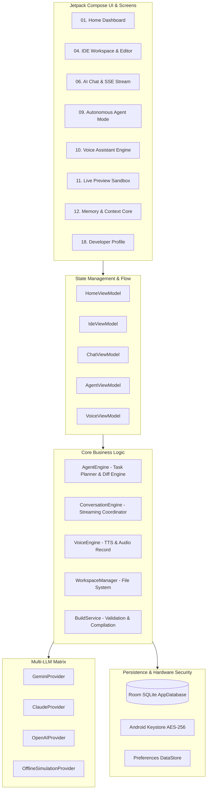

# ⚡ S.A.M. AI IDE (Smart Autonomous Machine)

<div align="center">


[-10B981?style=for-the-badge&logo=android&logoColor=white)](https://developer.android.com)
[](https://kotlinlang.org)
[](https://developer.android.com/jetpack/compose)
[](https://github.com/theshlok18/sam-ai-ide/actions)
[](LICENSE)

<p align="center">
  <b>A next-generation autonomous AI coding agent, full-stack IDE, and voice-assisted mobile development environment built natively for Android with Jetpack Compose & Material 3.</b>
</p>

[Key Features](#-key-features) • [Architecture](#-system-architecture) • [Tech Stack](#-tech-stack) • [Installation & Setup](#-getting-started) • [AI Matrix](#-multi-llm-intelligence-matrix) • [Prototypes](#-ui-screen-showcase) • [Creator](#-creator--architect)

---

</div>

## 🌌 Overview

**S.A.M. (Smart Autonomous Machine) AI IDE** transforms your Android device into a high-mobility AI pair programmer and autonomous engineering powerhouse. Designed with a **Cybernetic Zero-Glow Dark aesthetic**, SAM enables developers to plan, scaffold, code, refactor, preview, and build complete software projects directly on their mobile devices.

Whether you are writing Kotlin, JavaScript, Python, or HTML/CSS, SAM provides **instant AST code analysis**, **multi-agent task decomposition**, **human-in-the-loop approvals**, and **multilingual voice coding** (English, Marathi, Hindi).

---

## ⚡ Key Features

### 🤖 1. Autonomous Agent Mode
- **Zero-Prompt Task Decomposition**: Automatically breaks high-level developer requests into sequential, atomic execution steps.
- **Human-in-the-Loop Diff Verification**: Visual side-by-side unified code diffs (`+` additions, `-` deletions) before any file modifications are applied.
- **AST Code Synthesis**: Smart file-tree exploration, automated dependency resolution, and live build validation.

### 🧠 2. Multi-LLM Intelligence Matrix
- Seamlessly toggle and stream responses with real-time SSE (Server-Sent Events) from industry-leading models:
  - 🟢 **Google Gemini** (`gemini-2.0-flash`, `gemini-1.5-pro`)
  - 🟣 **Anthropic Claude** (`claude-3-5-sonnet-20241022`)
  - 🔵 **OpenAI** (`gpt-4o`, `gpt-4o-mini`, `o1-preview`)
  - ⚡ **Offline Simulation Engine** (Instant mock-testing without network or API tokens)

### 🎙️ 3. Multilingual Voice-First Engineering
- Built-in speech recognition and synthesis engine with interactive audio waveform visualizers.
- Full trilingual support: **English**, **मराठी (Marathi)**, and **हिंदी (Hindi)**.
- Hands-free coding, prompt execution, and real-time audio summaries.

### 💻 4. Full-Stack Mobile IDE Workspace
- **Multi-Tab File Editor**: Tabbed code editing with syntax-aware line counters, undo/redo buffers, and search.
- **Workspace File Tree**: Project explorer with rapid file creation, renaming, deletion, and directory management.
- **Context-Aware Terminal & Logs**: Live build logs, compilation errors, and task output stream.

### 📱 5. Real-Time Live Preview & Sandbox
- Interactive WebView sandbox rendering web apps, HTML/CSS/JS prototypes, and Canvas components.
- Multi-viewport responsive simulation: **Mobile (375px)**, **Tablet (768px)**, and **Desktop (1024px)**.
- Console error inspection and live reload.

### 🛡️ 6. Local-First Security & Keystore Encryption
- All API credentials are encrypted with hardware-backed **Android Keystore (AES-256 GCM)**.
- Local SQLite Room Database for chat history, project workspaces, and memory core.
- Zero tracking, telemetry, or source code leakage.

---

## 📐 System Architecture



---

## 🛠️ Tech Stack

| Component | Technology | Description |
|---|---|---|
| **Language** | Kotlin 2.0.21 | 100% Modern Kotlin with Coroutines & StateFlow |
| **UI Framework** | Jetpack Compose (BOM 2024.10.01) | Declarative UI with Material 3 Design Tokens |
| **Architecture** | Clean Architecture + MVVM | Unidirectional Data Flow (UDF) |
| **Database** | Room 2.6.1 + KSP | SQLite ORM with Coroutine DAOs |
| **Security** | AndroidX Security Crypto 1.1.0 | Hardware-backed Keystore Encryption |
| **Networking** | OkHttp 4.12.0 + OkHttp-SSE | Streaming AI responses with token counters |
| **Navigation** | Navigation Compose 2.8.3 | Type-safe single-activity navigation |
| **Target SDK** | Android SDK 35 (Android 15) | Min SDK 26 (Android 8.0+) |

---

## 🚀 Getting Started

### Prerequisites
- **Android Studio** Ladybug (2024.2.1+) or Koala Feature Drop
- **JDK 17** or higher
- **Android SDK API 35** and Build Tools `35.0.0`
- Physical Android Device or Android Emulator (API 26+)

### Clone the Repository
```bash
git clone https://github.com/theshlok18/sam-ai-ide.git
cd sam-ai-ide
```

### Build & Run via CLI

#### On Windows (PowerShell):
```powershell
# Build Debug APK
.\gradlew.bat assembleDebug

# Install on connected device/emulator
.\gradlew.bat installDebug
```

#### On Linux / macOS:
```bash
# Make gradlew executable
chmod +x ./gradlew

# Build Debug APK
./gradlew assembleDebug

# Install on connected device/emulator
./gradlew installDebug
```

Generated APK location:
```
app/build/outputs/apk/debug/app-debug.apk
```

---

## 🔑 AI Provider Configuration

SAM AI IDE allows you to configure your own API keys securely within the app:

1. Open **S.A.M. AI IDE** on your device.
2. Navigate to **Settings** > **AI Providers & Models**.
3. Enter your API key for any of the supported providers:
   - **Google Gemini API**: [Google AI Studio](https://aistudio.google.com/)
   - **Anthropic Claude API**: [Anthropic Console](https://console.anthropic.com/)
   - **OpenAI API**: [OpenAI Platform](https://platform.openai.com/)
4. Keys are immediately stored securely inside the hardware-backed **Android Keystore** with AES-256 GCM encryption.

---

## 🎨 UI Screen Showcase & Interactive Prototypes

SAM AI IDE comes with **19 interactive responsive web prototypes** in the [`ui/screens`](ui/screens/) directory. You can preview them directly in any browser by opening [`ui/index.html`](ui/index.html):

| # | Screen / Module | Description |
|---|---|---|
| 01 | [Home Dashboard](ui/screens/01_home_dashboard.html) | System metrics, quick actions, active project cards |
| 04 | [AI IDE Workspace](ui/screens/04_ai_ide_workspace.html) | Split editor, file tree, code terminal |
| 05 | [Code Editor](ui/screens/05_code_editor.html) | Syntax-highlighted mobile code editor |
| 06 | [AI Chat Matrix](ui/screens/06_ai_chat.html) | Streaming chat with markdown and code copy |
| 09 | [Autonomous Agent Mode](ui/screens/09_agent_mode.html) | Multi-step task planner, diff reviewer, approval flow |
| 10 | [Voice Assistant](ui/screens/10_voice_assistant.html) | Multilingual voice coding with live audio wave |
| 11 | [Live Preview](ui/screens/11_live_preview.html) | Real-time viewport sandbox with HTML/CSS/JS rendering |
| 12 | [Memory Core](ui/screens/12_memory_core.html) | Project knowledge vectors and context graph |
| 13 | [AI Providers](ui/screens/13_ai_providers_models.html) | Model selector, token temperature, API key vault |
| 18 | [Developer Profile](ui/screens/18_developer_profile.html) | Architect bio, design principles, and credentials |

---

## 📦 Project Structure

```
sam-ai-ide/
├── .github/
│   └── workflows/
│       └── build-deploy.yml     # Automated CI/CD pipeline for APK builds & releases
├── app/
│   ├── src/
│   │   ├── main/
│   │   │   ├── AndroidManifest.xml
│   │   │   ├── java/com/shlok/sam/
│   │   │   │   ├── SAMApplication.kt
│   │   │   │   ├── MainActivity.kt
│   │   │   │   ├── agent/       # Autonomous Agent Engine & Step Executor
│   │   │   │   ├── ai/          # Gemini, Claude, OpenAI & Simulation Providers
│   │   │   │   ├── data/        # Room Database, DAOs, Entities, Keystore
│   │   │   │   ├── ide/         # Workspace Manager & Build Services
│   │   │   │   ├── navigation/  # Jetpack Compose Navigation Graph
│   │   │   │   ├── ui/          # Compose Screens, Themes, Colors, Components
│   │   │   │   ├── viewmodel/   # MVVM StateFlow ViewModels
│   │   │   │   └── voice/       # Multilingual Speech Recognition & TTS
│   │   │   └── res/             # Vector Drawables, Colors, Themes, XML configs
│   │   └── test/                # Unit Tests
│   └── build.gradle.kts         # App-level dependencies & build rules
├── gradle/
│   └── libs.versions.toml       # Version Catalog
├── ui/                          # Interactive UI prototypes & HTML/CSS/JS mockups
│   ├── index.html               # Master Prototype Navigator
│   └── screens/                 # 19 standalone responsive screen mockups
├── build.gradle.kts             # Top-level build configuration
├── settings.gradle.kts          # Plugin & repository settings
└── README.md                    # Project Documentation
```

---

## 👨‍💻 Creator & Architect

<div align="center">

**Shlok**  
*CSE & AI Systems Architect*

Creator and lead architect of **S.A.M. (Smart Autonomous Machine)**.

[](https://github.com/theshlok18)
[](https://github.com/theshlok18/sam-ai-ide)

</div>

---

## 📄 License

This project is licensed under the [MIT License](LICENSE) — feel free to use, modify, and distribute with attribution.
